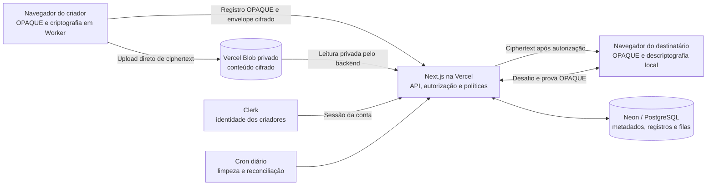

# Efemero

Compartilhamento temporário de mensagens e arquivos, com criptografia no navegador, autenticação por senha antes da entrega e políticas de expiração aplicadas pelo servidor.

**Aplicação:** [efemero.rafael.run](https://efemero.rafael.run). **Repositório:** privado, em `toruticas/efemero`. O nome do projeto, dos identificadores e do domínio usa a forma ASCII `efemero`.

O destinatário precisa do link e da senha do artefato. A URL não contém chave, senha ou fragmento secreto. O servidor controla novas entregas; nenhuma política consegue apagar uma cópia que o destinatário já recebeu.

## Índice

- [Estado e alcance da validação](#estado-e-alcance-da-validação)
- [Modelo do produto](#modelo-do-produto)
- [Arquitetura e escolhas de tecnologia](#arquitetura-e-escolhas-de-tecnologia)
- [Senha, OPAQUE e chaves de conteúdo](#senha-opaque-e-chaves-de-conteúdo)
- [Fluxos de criação e abertura](#fluxos-de-criação-e-abertura)
- [Expiração, kill-switch e remoção](#expiração-kill-switch-e-remoção)
- [Privacidade, estatísticas e retenção](#privacidade-estatísticas-e-retenção)
- [Limites e proteção contra abuso](#limites-e-proteção-contra-abuso)
- [Riscos e limites de segurança](#riscos-e-limites-de-segurança)
- [Desenvolvimento e configuração](#desenvolvimento-e-configuração)
- [Publicação e operação](#publicação-e-operação)
- [Estrutura do repositório e API](#estrutura-do-repositório-e-api)
- [Validação e próximos trabalhos](#validação-e-próximos-trabalhos)

## Estado e alcance da validação

O projeto possui compartilhamento anônimo, área de conta, username imutável, IDs personalizados, histórico paginado, contadores agregados, revogação e kill-switch opcional implementados. A infraestrutura atual usa Vercel Hobby, Neon, Blob privado e Clerk.

Na verificação de 19/10/2026:

- O compartilhamento anônimo foi exercitado em Chromium contra os serviços reais: criação, senha incorreta, descriptografia de mensagem, download com bytes idênticos, revogação, limite de uma entrega e expiração sem depender do cron. Também foi transferido um arquivo anônimo de exatamente 2 MiB.
- Os cinco CNAMEs do Clerk estão configurados. HTTPS e carregamento dos formulários de entrada e cadastro funcionam. `/app` sem sessão redireciona para a entrada. As páginas públicas verificadas não carregam o SDK do Clerk.
- A última CI da implementação passou com **47 testes**, PostgreSQL 17 real, checagem de tipos, formatação e build de produção. O número descreve essa revisão, não uma garantia permanente.
- **Cadastro, verificação de e-mail, entrada e uso do painel com uma conta real em produção ainda precisam de validação de ponta a ponta.** Os testes de autorização no backend e de componentes com respostas simuladas não substituem esse exercício.
- A rota de limpeza e sua autorização foram testadas manualmente; isso não comprova a execução automática da próxima janela diária nem os prazos internos de exclusão dos provedores.

O projeto ainda não passou por auditoria criptográfica independente. Os limites abaixo fazem parte do modelo de segurança, mesmo quando todos os testes passam. O [registro de validação](docs/validation.md) contém evidências datadas; entradas antigas descrevem o estado da época e podem anteceder correções posteriores.

## Modelo do produto

### Artefatos e endereços

Um artefato contém uma mensagem ou um arquivo. Conteúdo e política são definidos na criação e permanecem imutáveis depois da publicação.

| Modalidade | Formato do endereço | Identificação e gerenciamento                                                                           |
| ---------- | ------------------- | ------------------------------------------------------------------------------------------------------- |
| Anônima    | `/a/:id`            | Dispensa login; ID aleatório e credencial separada para revogação.                                      |
| Conta      | `/:username/:id`    | Exige sessão Clerk e username; permite ID aleatório ou personalizado e gerenciamento pelo proprietário. |

O ID anônimo usa 9 bytes aleatórios codificados em base64url, resultando em 12 caracteres. Um ID personalizado aceita de 1 a 48 caracteres ASCII, começa com letra ou número e pode conter letras, números, `_` e `-`. IDs personalizados podem ser previsíveis: a segurança do conteúdo não deve depender de esconder o endereço.

O username tem de 3 a 24 caracteres, começa com letra minúscula e aceita letras minúsculas, números, `_` e `-`. Nomes usados pelo sistema são reservados. A imutabilidade é aplicada pela API e por um trigger no banco. O username é público nas URLs e não deve conter informação que o criador queira manter privada.

Uma combinação de prefixo e ID nunca é reutilizada, mesmo após a remoção do conteúdo. Isso evita que um link antigo passe a apontar para um novo artefato. Essa decisão exige manter registros residuais no banco, com consequências de privacidade e crescimento descritas adiante.

### Política definida na criação

Todo artefato tem um prazo obrigatório. Também pode ter um limite de entregas autorizadas e, na modalidade de conta, um limite de falhas de senha.

Não há atualização de conteúdo, troca ou recuperação da senha do artefato, extensão de prazo, mudança de ID, alteração de limites ou desbloqueio. O proprietário pode revogar/remover o artefato de forma permanente. Para publicar outra versão, cria outro artefato em outro endereço.

O login Clerk autentica o **criador** e autoriza histórico e gerenciamento. A senha do artefato autentica o **destinatário** e permite recuperar a chave de conteúdo no navegador. Entrar na conta não substitui essa senha nem oferece uma função de recuperação do conteúdo. A senha de login, quando usada pelo Clerk, pertence a um fluxo separado da senha do artefato.

## Arquitetura e escolhas de tecnologia



Na operação normal, o navegador vê senha, texto, arquivo e chaves em claro. A API recebe mensagens OPAQUE e metadados necessários às políticas; o Blob recebe bytes cifrados. O servidor tem segredos próprios de autenticação e acesso à infraestrutura. Essa separação reduz a exposição de dados, mas não torna o operador incapaz de atacar senhas ou de modificar o frontend servido ao usuário.

| Tecnologia                             | Função e motivo da escolha                                                                                   | Custo ou limitação da escolha                                                                                                    |
| -------------------------------------- | ------------------------------------------------------------------------------------------------------------ | -------------------------------------------------------------------------------------------------------------------------------- |
| Next.js 16, React 19 e TypeScript      | Interface e API no mesmo projeto, com integração direta à Vercel.                                            | Dependência do framework, das atualizações de segurança e da configuração de cache, headers e runtime.                           |
| Vercel Functions, runtime Node.js      | Backend sem manter um servidor dedicado; recebe provas e transmite o objeto autorizado.                      | Duração limitada, dependência da plataforma e consumo de requisições e transferência. As rotas têm `maxDuration` de 60 segundos. |
| Neon / PostgreSQL                      | Estado persistente, consultas parametrizadas e transações com bloqueio de linha para políticas concorrentes. | Banco indisponível impede autorizações. Muitas chamadas abusivas também podem consumir capacidade do banco.                      |
| Vercel Blob **privado**                | Armazena ciphertext; upload direto evita encaminhar arquivos pelo corpo da API Next.js.                      | Exclusão física é assíncrona; tokens, consistência operacional e limites do provedor precisam ser considerados.                  |
| Clerk                                  | Cadastro e sessão dos criadores, sem construir um sistema próprio de identidade.                             | Serviço externo com DNS, certificados, disponibilidade e processamento de dados próprios.                                        |
| `@serenity-kit/opaque` 1.1.0           | Implementação OPAQUE em Rust/WASM, fixada no lockfile, para autenticação sem transmitir a senha do artefato. | Integração criptográfica sensível, custo de memória e necessidade de administrar segredos do servidor.                           |
| Web Crypto e Web Worker                | AES-GCM e HKDF nativos do navegador; trabalho criptográfico fora da thread da interface.                     | Worker não é um enclave seguro. Memória, navegador e JavaScript entregue continuam na fronteira de confiança.                    |
| Zod                                    | Validação estrita das entradas e rejeição de campos inesperados.                                             | Validação de formato não prova correção criptográfica nem torna confiável um cliente modificado.                                 |
| Vitest, PGlite e PostgreSQL real na CI | Testes rápidos e verificação de transações e concorrência com conexões independentes.                        | Testes não cobrem todos os navegadores, provedores ou cenários adversariais.                                                     |

Não há Redis, broker externo ou serviço de filas adicional. Handshakes, limites de requisição e fila de exclusão ficam no PostgreSQL, reduzindo componentes operacionais. As garantias de concorrência dependem desse estado compartilhado, sem contadores locais em memória de uma Function.

O backend é transiente na execução das requisições, mas banco e storage são persistentes até a limpeza. O produto não depende de um processo permanentemente ligado para manter um temporizador por artefato.

## Senha, OPAQUE e chaves de conteúdo

### Por que não enviar um hash estático da senha?

Se a API aceitasse sempre `hash(salt + senha)` como credencial, quem obtivesse esse valor poderia potencialmente reapresentá-lo, mesmo sem descobrir a senha original. Um verificador estático também oferece uma forma de conferir palpites offline. Salt dificulta tabelas pré-calculadas; não impede testar uma lista de senhas. MD5 e SHA-256 isolados são rápidos demais para proteger senhas humanas contra esse tipo de tentativa.

OPAQUE é um protocolo de autenticação por senha com troca de mensagens e prova vinculada à sessão. O navegador processa a senha, o servidor participa com material secreto próprio e a API exige uma prova final válida antes de buscar o conteúdo cifrado. A senha do artefato não é enviada à API, nem durante sua criação. Os schemas não aceitam um campo de senha; isso não dispensa manter logs e instrumentação livres de dados sensíveis.

O identificador criptográfico do cliente é o UUID interno e imutável do artefato. A identidade do servidor é a origem canônica em `APP_ORIGIN`. Username e ID curto apenas localizam o registro. Alterar a origem canônica ou o material OPAQUE sem uma estratégia de migração pode impedir a abertura de artefatos existentes.

### Segredos e responsabilidades

| Material                    | Onde é usado                                   | O que protege e o que não protege                                                                                                                                        |
| --------------------------- | ---------------------------------------------- | ------------------------------------------------------------------------------------------------------------------------------------------------------------------------ |
| Senha do artefato           | Navegador do criador e do destinatário         | Permite autenticação e recuperação da chave. Senha fraca continua sujeita a palpites.                                                                                    |
| `OPAQUE_SERVER_SETUP`       | Backend, fora das tabelas de artefatos         | Contém material OPRF e chave privada de autenticação do servidor. É necessário para participar do protocolo e deve ser tratado como segredo crítico.                     |
| Registro OPAQUE             | PostgreSQL, por artefato                       | Permite autenticação junto do setup. Não é senha em claro, mas também não é um registro inofensivo se os segredos do servidor vazarem.                                   |
| `exportKey` do cliente      | Worker do navegador                            | Origina a chave que envolve a chave do conteúdo; não é enviada à API.                                                                                                    |
| `sessionKey` OPAQUE         | Disponível aos participantes do protocolo      | **Não cifra nem envolve a chave do conteúdo**, pois o servidor também a conhece.                                                                                         |
| Chave de conteúdo, ou DEK   | Aleatória, por artefato; em claro no navegador | Cifra mensagem/arquivo e seus metadados originais. No banco fica somente seu envelope cifrado.                                                                           |
| `HANDSHAKE_SEAL_KEY`        | Backend                                        | Cifra o estado temporário do protocolo no banco, vinculado ao artefato. Não substitui a proteção do setup OPAQUE.                                                        |
| Credencial de gerenciamento | Entregue ao criador; hash SHA-256 no banco     | Autoriza operações de gerenciamento, incluindo revogação. É um segredo aleatório de 256 bits, independente da senha. Seu hash não é um verificador da senha do artefato. |

**Limite fundamental:** quem obtiver o material OPRF do servidor e um registro correspondente pode executar tentativas de senha offline. A posse da chave privada de autenticação do servidor não é necessária para esse ataque de dicionário com OPRF e registro. O operador possui acesso técnico a esses materiais. OPAQUE aumenta a proteção de um vazamento isolado do banco, mas não garante resistência a um comprometimento completo da aplicação nem a um operador malicioso.

OPAQUE não cifra sozinho o arquivo. Ele autentica o destinatário e permite ao cliente recuperar material estável para abrir o envelope da chave, conforme o fluxo abaixo.

### Formato criptográfico implementado

1. O navegador executa o registro OPAQUE e recupera a `exportKey`. O perfil `memory-constrained` da biblioteca usa Argon2id com 64 MiB de memória, 3 iterações e paralelismo 4.
2. Uma DEK aleatória de 32 bytes cifra o payload com AES-256-GCM e nonce aleatório de 12 bytes. O payload inclui um tamanho de cabeçalho de 4 bytes, um JSON com tipo, nome e MIME e os bytes do conteúdo. Nome e MIME originais também ficam cifrados.
3. HKDF-SHA-256 deriva uma chave de envolvimento a partir da codificação UTF-8 da `exportKey`, com o UUID como salt e `artefatos:key-wrap:v1` como contexto.
4. Outra operação AES-GCM, com nonce independente, cifra a DEK. O banco guarda versão, nonce e ciphertext desse envelope, além do registro OPAQUE.
5. O ciphertext do payload contém um byte de versão, o nonce e os bytes cifrados com a tag GCM. O dado adicional autenticado, tanto para conteúdo quanto para envelope, é `artefatos:payload:v1:<UUID>`.

Os prefixos internos `artefatos:*` são parte do protocolo existente, apesar do nome público Efemero. Não devem ser renomeados como uma alteração cosmética: isso quebraria a compatibilidade criptográfica. O formato da aplicação está na versão 1.

GCM detecta alteração dos bytes sem a chave correta, e os contextos vinculam a operação ao artefato. Isso não comprova a identidade humana do remetente nem a segurança do arquivo recebido. Uma pessoa com a senha pode copiar e redistribuir o conteúdo.

## Fluxos de criação e abertura

### Criação

1. O navegador valida a entrada e inicia o registro OPAQUE no Worker. Na modalidade de conta, a API valida a sessão e resolve o proprietário no servidor.
2. `reserve` reserva UUID, endereço, prazo, orçamento de bytes e política. O backend retorna a resposta OPAQUE e a credencial de gerenciamento. O prazo começa nessa reserva, não ao fim do upload.
3. O navegador finaliza o registro, cifra o payload e envolve a DEK. A senha, a DEK em claro e a `exportKey` permanecem no cliente.
4. `upload` autoriza uma única emissão de token para o caminho reservado no Blob privado, com tamanho limitado, tipo `application/octet-stream`, sem sobrescrita e sem multipart. O token vence em até 15 minutos, limitado também pelo prazo do artefato.
5. O navegador faz upload direto do ciphertext. `commit`, autorizado pela credencial de gerenciamento, entrega registro OPAQUE e envelope cifrado. O backend confere caminho, tamanho, tipo e storage privado antes de publicar.

Uma reserva abandonada não fica publicamente disponível. Publicar novamente, substituir um objeto ou reviver um artefato expirado/revogado não é uma operação suportada.

### Abertura e entrega

1. Abrir a página não baixa o ciphertext. Para artefatos de conta, a interface envia um evento agregado de abertura, sem identificar o destinatário.
2. Após o usuário informar a senha, o navegador inicia OPAQUE. `access/start` verifica estado, prazo e limites antes de devolver o desafio. O estado temporário do servidor fica cifrado no banco por até 120 segundos, ou menos se o artefato vencer antes.
3. O navegador processa o desafio. Uma senha incorreta não produz uma prova válida; o cliente oficial envia uma prova inválida para concluir a tentativa. Abandonar a troca também é considerado na política de kill-switch.
4. `access/finish` abre uma transação, bloqueia a linha do artefato, resolve tentativas vencidas e consome o handshake uma única vez. Só uma prova válida pode incrementar o contador de entregas.
5. A autorização é confirmada no banco **antes** da leitura do Blob. O backend lê o objeto privado sem cache e transmite os bytes na resposta desse POST. O envelope da DEK vai em `X-Wrapped-Key`, e o UUID em `X-Artifact-Id`.
6. O navegador recupera a chave e descriptografa localmente. Mensagens são exibidas como texto; arquivos são oferecidos como download binário, sem renderização de documentos ativos na origem do site.

Não é fornecida uma URL GET assinada reutilizável para o destinatário contornar os contadores. A resposta usa `private, no-store` e `nosniff`. Esses headers orientam clientes e intermediários; não impedem um cliente autorizado de salvar bytes.

Uma entrega autorizada pode consumir o limite mesmo que o storage, a rede ou a descriptografia falhem depois. Não há reembolso automático nem retomada do download. Autorizar primeiro evita que a mesma prova seja reutilizada para obter várias entregas.

Bloqueios de linha serializam provas concorrentes, último acesso, revogação e kill-switch. Uma transferência já autorizada pode continuar após uma revogação concorrente: a política impede **novas autorizações**, sem recolher bytes já liberados.

## Expiração, kill-switch e remoção

### Estados

| Estado      | Significado                                                                                     |
| ----------- | ----------------------------------------------------------------------------------------------- |
| `pending`   | Reserva ainda não publicada; janela de publicação de até 15 minutos, limitada pelo prazo total. |
| `ready`     | Publicado, sujeito às verificações de prazo e limites em cada autorização.                      |
| `revoked`   | Revogado pelo proprietário ou pela credencial de gerenciamento.                                 |
| `expired`   | Prazo encerrado ou reserva abandonada processada pela limpeza.                                  |
| `exhausted` | Limite de entregas autorizadas atingido.                                                        |
| `destroyed` | Limite de falhas do kill-switch atingido.                                                       |

`purged_at` registra separadamente a conclusão da exclusão do objeto. Um estado terminal não significa que todas as cópias físicas desapareceram naquele instante. O histórico pode apresentar o estado efetivo de expiração antes de a limpeza persistir essa transição.

O prazo é checado no início e na finalização da autenticação, usando o relógio do servidor. Portanto, acesso vencido é recusado mesmo se o cron não executar. No caso da expiração por tempo, a remoção do registro OPAQUE e do envelope do banco ocorre quando a limpeza processa o artefato. Revogação, último acesso e kill-switch removem esses materiais na própria transação que encerra a disponibilidade.

### Kill-switch: proteção com risco de negação de serviço

Na modalidade de conta, o criador pode definir de 1 a 100 falhas acumuladas. A opção é desativada por padrão e fica imutável após a criação. Uma autenticação correta não zera falhas anteriores.

Uma prova inválida consome o handshake e conta uma falha. Para impedir que um cliente simplesmente omita a resposta após descobrir que errou, handshakes abandonados também contam ao vencer. A resolução ocorre no próximo início/finalização de acesso ou pela limpeza; não existe um temporizador dedicado executando exatamente no segundo 120.

O número de desafios pendentes é limitado pelo orçamento restante de falhas. Se todos os espaços estiverem ocupados, novos inícios recebem recusa temporária, em vez de destruir o artefato apenas por iniciar desafios adicionais.

**Qualquer pessoa que conheça o link pode provocar falhas ou abandonar desafios deliberadamente e destruir o artefato.** Fechar a página, uma conexão lenta ou uma interrupção de rede também podem consumir tentativas, inclusive quando a pessoa pretendia usar a senha correta. Esse é um compromisso inerente ao recurso, não uma forma de distinguir atacantes de destinatários legítimos.

### Limpeza física e reconciliação

O cron da Vercel chama `/api/cron/cleanup` diariamente, com `CRON_SECRET`. A fila persistida no PostgreSQL usa leases e `FOR UPDATE SKIP LOCKED` para coordenar execuções e permitir repetição após falhas.

A exclusão respeita uma janela de segurança: a elegibilidade considera o instante atual, 90 segundos após a última entrega autorizada e 90 segundos após a validade do token de upload, conforme aplicável. Isso evita interferir em transferências autorizadas e reduz corridas com uploads ainda válidos.

Uma chamada drena lotes de 20 trabalhos, com orçamento de 45 segundos e até 500 lotes, dentro da Function configurada para 60 segundos. Falhas adiam a elegibilidade em 5 minutos; **isso não garante nova execução em 5 minutos**, porque o agendador é diário. A resposta indica `limited` quando o orçamento se esgota.

Há também inventário paginado do Blob, com cursor persistido, para remover objetos que reapareçam após um upload iniciado antes do vencimento do token. A reconciliação pode exigir várias execuções para percorrer o storage.

Backlog, indisponibilidade, falha do agendador ou duração excedida podem atrasar a exclusão física além do próximo dia. Não há SLA de remoção em 24 horas nem comprovação de apagamento de backups, caches ou réplicas internas dos provedores. A expiração do acesso não depende dessa exclusão.

## Privacidade, estatísticas e retenção

### O que cada parte conhece

| Local                               | Dados presentes na operação normal                                                                                                                                          |
| ----------------------------------- | --------------------------------------------------------------------------------------------------------------------------------------------------------------------------- |
| Navegador                           | Senha do artefato, conteúdo, nome e MIME originais, chaves temporárias; o destinatário pode guardar a cópia.                                                                |
| PostgreSQL                          | Conta e ID Clerk, username, URL, UUID, datas, política, tamanho declarado, estado, contadores, caminho de storage, registro OPAQUE e envelope cifrado enquanto necessários. |
| Blob privado                        | Payload cifrado, tamanho e metadados operacionais do objeto; nome original e MIME estão dentro do payload cifrado.                                                          |
| Clerk                               | Dados de identidade, sessão e mecanismos de proteção de acesso conforme configuração e políticas do serviço.                                                                |
| Infraestrutura de rede e provedores | Podem observar IPs, hostname, URLs acessadas, horários, tamanhos e logs operacionais conforme sua posição e suas políticas.                                                 |

Não há padding para ocultar o tamanho. O tamanho do ciphertext permite inferir aproximadamente o tamanho do conteúdo. Datas, frequência de acesso e usernames também podem revelar relações entre usuários e artefatos.

“Anônimo” significa que criar e receber não exige conta. Não significa anonimato de rede, impossibilidade de correlação ou ausência de logs nos provedores. Recomenda-se compartilhar a senha por um canal separado do link e evitar informações sensíveis no username ou no ID personalizado, que são públicos.

O código não adiciona analytics de destinatários nem registra intencionalmente senha, conteúdo, mensagens OPAQUE, credenciais ou erros brutos de provedores nos handlers. A telemetria opcional do SDK Clerk está desativada. Isso não desativa os mecanismos de proteção do Clerk nem constitui uma garantia sobre todo o logging da infraestrutura.

### O que os contadores medem

O painel lista metadados dos artefatos da conta, com paginação, estado e remoção permanente. Não guarda uma cópia em claro do conteúdo para o proprietário.

- **Aberturas:** eventos agregados enviados pela interface do destinatário. São uma estimativa; recargas, bots, bloqueadores, falhas de rede e chamadas artificiais podem alterar o número. Não são pessoas únicas nem uma trilha de destinatários.
- **Entregas autorizadas:** provas OPAQUE aceitas que consumiram uma autorização. Não comprovam download concluído, descriptografia bem-sucedida ou leitura humana.
- **Falhas:** tentativas contabilizadas pela política de kill-switch, incluindo desafios abandonados resolvidos após o vencimento.

Não existe uma medida confiável de “número de descriptografias” em um cliente sob controle do destinatário. Uma confirmação enviada pelo navegador poderia ser omitida ou fabricada. Por isso o produto não apresenta esse número como fato verificável.

### O que permanece depois da exclusão

Após a remoção do objeto, a limpeza apaga do registro seu URL de storage, hash de gerenciamento e materiais do protocolo. O histórico da conta deixa de listar artefatos purgados há mais de 30 dias. Uma limpeza posterior remove desses registros o vínculo direto `owner_id`, zera contadores e reduz outros campos associados ao histórico.

**A linha do artefato não é apagada.** Permanecem registros residuais, ou tombstones, para impedir reutilização de URLs. Eles ainda incluem endereço, UUID, namespace, slug, estado, timestamps e campos operacionais. O namespace de um artefato de conta continua sendo o username público: remover `owner_id` não torna esse registro anônimo. Os tombstones anônimos também não passam por uma exclusão geral de todos os seus metadados.

As contas e seus usernames permanecem no banco; não há fluxo completo de exclusão de conta ou sincronização de exclusão a partir do Clerk implementado. Os tombstones crescem sem um prazo final de remoção. A retenção de 30 dias é uma regra do histórico após o purge, não uma promessa de apagar todos os dados da pessoa em 30 dias.

As chaves dos limitadores são HMACs de identidade de rede, escopo e janela temporal, sem armazenar o IP bruto nessa tabela. As linhas vencem logicamente ao terminar a janela e são removidas pela limpeza; podem permanecer fisicamente por mais tempo se ela falhar. HMAC não torna IPs dados impossíveis de correlacionar para quem controla o segredo.

Backups e registros dos provedores têm ciclos próprios. Restaurar um banco antigo pode restaurar metadados ou permissões antigas; recuperação operacional exige reavaliar prazos, revogações e objetos. Não há um procedimento automatizado completo de recuperação de desastre com essas garantias.

## Limites e proteção contra abuso

### Limites da aplicação

| Recurso                                        | Limite atual                                                                |
| ---------------------------------------------- | --------------------------------------------------------------------------- |
| Arquivo anônimo                                | 2 MiB de conteúdo no cliente oficial.                                       |
| Arquivo criado na área de conta                | 5 MiB de conteúdo no cliente oficial.                                       |
| Mensagem                                       | 256 KiB.                                                                    |
| Prazo                                          | De 1 minuto a 7 dias, obrigatório, contado desde a reserva.                 |
| Entregas autorizadas                           | Opcional, de 1 a 100; sem limite de contagem continua havendo prazo.        |
| Kill-switch                                    | Opcional, de 1 a 100 falhas acumuladas, somente para artefatos de conta.    |
| Senha no cliente oficial                       | De 12 a 256 caracteres; prefira senha gerada ou frase longa e imprevisível. |
| Artefatos ainda não purgados por conta         | 50, incluindo reservas e itens aguardando exclusão.                         |
| Orçamento global de objetos ainda não purgados | 1 GiB de tamanhos cifrados declarados, reservado atomicamente no banco.     |
| Corpo JSON nas rotas de controle               | Até 32 KiB; arquivos são enviados diretamente ao Blob.                      |
| Handshake de abertura                          | Até 120 segundos, limitado pelo prazo do artefato.                          |

MiB corresponde a `1024 × 1024` bytes. A interface usa o rótulo MB; os limites do código são binários. A API admite uma margem de até 4 KiB no orçamento de ciphertext para o cabeçalho e os bytes adicionais do formato cifrado. O envelope da DEK é armazenado separadamente no banco. Como não vê o conteúdo em claro, ela limita os bytes cifrados e não consegue verificar exatamente o tamanho original ou o tipo de conteúdo de um cliente modificado. A restrição de tamanho de mensagem também é aplicada no cliente oficial.

O mesmo vale para a qualidade e o tamanho da senha: como a API não recebe a senha, não pode comprovar sua entropia ou impor a validação textual do cliente. Um cliente modificado pode escolher uma senha fraca. Não há uma política criptográfica que transforme essa escolha em uma senha forte.

O leitor mantém compatibilidade com ciphertexts antigos de até 25 MiB mais a margem de formato. Isso não permite novos uploads de 25 MiB; novos artefatos obedecem aos limites de 2/5 MiB.

### Limites de requisição

São janelas fixas com atualização atômica em PostgreSQL. “Por rede” significa a identidade derivada do header de encaminhamento da Vercel; fora da Vercel, as requisições compartilham uma identidade local conservadora, sem confiar em headers de IP arbitrários.

| Operação                  | Por rede              | Outros limites                                                 |
| ------------------------- | --------------------- | -------------------------------------------------------------- |
| Reservar artefato         | 5 por hora            | 100 por hora no serviço.                                       |
| Emitir token de upload    | 20 por hora           | Regras do token e da reserva.                                  |
| Publicar                  | 30 por hora           | Credencial de gerenciamento e estado da reserva.               |
| Iniciar abertura          | 30 a cada 15 minutos  | 15 por artefato a cada 15 minutos; 600 por minuto no serviço.  |
| Finalizar abertura        | 60 a cada 15 minutos  | Handshake de uso único e política do artefato.                 |
| Contar abertura de página | 120 a cada 15 minutos | 120 por artefato a cada 15 minutos; 600 por minuto no serviço. |
| Revogar                   | 30 por hora           | Credencial ou sessão do proprietário.                          |
| Definir username          | 10 por hora           | Uma definição por conta, sem atualização.                      |

As cotas de rede são compartilhadas por pessoas atrás de NAT e não somem por estar autenticado. Algumas verificações ocorrem antes da validação completa; requisições inválidas podem consumir cota. Ataques distribuídos, limites globais e contenção no banco ainda podem impedir uso legítimo. Esses mecanismos reduzem abuso, mas não garantem resistência a DDoS nem um teto de cobrança.

O orçamento de 1 GiB limita reservas de objetos, não transferência, armazenamento total do banco, tombstones, operações de API ou todos os custos dos provedores. Os valores são decisões deste projeto, não uma reprodução das cotas comerciais de cada plano.

## Riscos e limites de segurança

Os cenários abaixo descrevem compromissos e modos de falha do sistema. Não devem ser interpretados como um relatório de vulnerabilidades exploradas ou como uma auditoria concluída.

| Cenário                                         | Proteção existente                                                               | Risco que permanece                                                                                                                                           |
| ----------------------------------------------- | -------------------------------------------------------------------------------- | ------------------------------------------------------------------------------------------------------------------------------------------------------------- |
| Pessoa conhece o link, sem senha                | OPAQUE antes da entrega, Blob privado e limites de tentativa.                    | Palpites online, enumeração de endereços e negação de serviço. URLs não são credenciais secretas e a existência de um artefato não é totalmente ocultada.     |
| Vazamento isolado do banco ou storage           | Conteúdo e DEK cifrados; setup OPAQUE separado das tabelas.                      | Metadados vazam. A proteção deixa de ser a mesma se o atacante também obtiver os segredos do backend.                                                         |
| Vazamento de material OPRF e registros          | Custo de derivação Argon2id e senhas fortes.                                     | Ataques de dicionário offline não obedecem a rate limit ou kill-switch. “Hash não reversível” não significa “senha impossível de descobrir”.                  |
| Operador, deploy ou dependência maliciosa       | CSP, dependências fixadas e separação de scripts reduzem superfícies acidentais. | Quem altera o JavaScript entregue pode capturar senha e plaintext antes da criptografia. O operador também tem capacidade técnica para testar senhas offline. |
| Navegador, extensão ou dispositivo comprometido | Worker, uso de Web Crypto e limpeza de alguns buffers.                           | Captura de tela, clipboard, memória, extensões, malware, swap e strings gerenciadas por garbage collection. Não há apagamento seguro garantido no navegador.  |
| Replay ou corrida de último acesso              | Handshake de uso único, transação e bloqueio da linha.                           | A transferência já autorizada pode continuar; falhas posteriores podem consumir a última liberação.                                                           |
| Kill-switch deliberadamente provocado           | Limites de requisição e orçamento de desafios pendentes.                         | Quem conhece a URL pode causar destruição sem saber a senha. Rede instável também pode consumir tentativas.                                                   |
| Cron atrasado ou storage indisponível           | Prazo verificado na API e fila persistente com repetição e reconciliação.        | Ciphertext e alguns materiais podem permanecer armazenados depois de o acesso ser bloqueado. Backups dos provedores não são apagados pela fila.               |
| Perda ou rotação incorreta de segredos          | Configuração separada e versão de setup registrada.                              | Pode tornar artefatos irrecuperáveis ou invalidar autenticações em andamento; não há keyring de migração implementado.                                        |
| Arquivo perigoso enviado por alguém autorizado  | Sem preview ativo, MIME binário e nome recuperado apenas no cliente.             | Não há varredura antimalware do conteúdo cifrado. Abrir o arquivo em outro aplicativo pode ser perigoso.                                                      |
| Comprometimento da conta Clerk                  | Controle de propriedade no backend; senha do artefato continua separada.         | O atacante pode consultar metadados e remover artefatos da conta. Administrar a conta não lhe dá automaticamente a senha de descriptografia.                  |
| Indisponibilidade ou limites dos provedores     | Sem entrega quando a autorização não pode ser comprovada.                        | Dependência de Vercel, Neon, Blob, Clerk e DNS. Falhar fechado protege o acesso, mas não mantém o serviço disponível.                                         |

### Defesas da aplicação e seu alcance

As mutações verificam a origem canônica e contexto cross-site, com tratamento próprio para callbacks autenticados do SDK de upload. Isso ajuda contra CSRF no navegador; `Origin` pode ser fabricado por um cliente fora do navegador e não substitui credencial, sessão ou prova OPAQUE.

A API usa schemas estritos, consultas SQL parametrizadas, escopo de proprietário resolvido no servidor e respostas de erro sem detalhes brutos dos provedores. Caminho de storage, conta e política não são aceitos como autoridade apenas porque vieram do cliente. O acesso ao Blob exige token de backend e a publicação confere o store privado.

A CSP usa nonce por resposta, `strict-dynamic`, suporte explícito a WASM e bloqueio de objetos e enquadramento. Produção não permite `unsafe-eval` para JavaScript; desenvolvimento tem permissões adicionais. Estilos inline continuam permitidos. Somente as páginas de conta recebem workers `blob:` e permissões adicionais do Clerk Protect, incluindo conexões HTTPS em portas não padrão. Essas permissões são uma dependência concreta da proteção do Clerk, não isolamento absoluto de scripts de terceiros.

As páginas públicas não montam o `ClerkProvider`; o fluxo de conta carrega seus próprios serviços. CSP reduz algumas formas de injeção, mas não protege contra código malicioso autorizado por um deploy, nem prova ausência de XSS em toda mudança futura.

O serviço não deve prometer “zero knowledge” absoluto, anonimato forte, apagamento irrecuperável ou segurança independente de senha, dispositivo e operador. TLS continua obrigatório em produção mesmo com a criptografia do conteúdo.

## Desenvolvimento e configuração

### Pré-requisitos e ambiente separado

- Node.js 22 ou superior e npm; a CI usa Node.js 24.
- Banco Neon de desenvolvimento, separado da produção, com permissão para migrações. O driver da aplicação usa a interface serverless/WebSocket do Neon; um PostgreSQL local arbitrário não é automaticamente intercambiável sem adaptar a conexão.
- Store Blob **privado**, dedicado ao ambiente, e seu token somente no backend.
- Instância/chaves de desenvolvimento do Clerk para exercitar contas. Sem elas, o compartilhamento anônimo pode funcionar, mas a área autenticada fica indisponível.

Não use banco, bucket ou segredos de produção no desenvolvimento ou em testes. A presença de um arquivo ignorado pelo Git não o torna seguro para compartilhar ou imprimir. Em especial, não deixe `.env.production.local` em um checkout usado para desenvolvimento: o runner de migrações carrega configuração via `@next/env`, cuja seleção pode priorizar arquivos de produção. Confira o destino efetivo em ambiente privado antes de migrar, sem imprimir a string de conexão em logs.

```sh
npm ci
cp .env.example .env.local
npm run setup:secrets
```

Preencha `.env.local` com a origem local, as conexões e os tokens do ambiente de desenvolvimento. Em seguida:

```sh
npm run db:migrate
npm run dev
```

O gerador preenche apenas segredos ausentes e não exibe valores. Preserva entradas já preenchidas; não valida nem corrige automaticamente placeholders ou configurações incorretas. Não o trate como procedimento de rotação de produção. `.env.local` e outros arquivos locais de ambiente são ignorados pelo Git.

Sem a configuração necessária, as telas podem continuar acessíveis, mas o compartilhamento fica desabilitado. Não existe fallback que envie a senha em claro ou libere conteúdo para contornar a falta de serviços.

### Variáveis de ambiente

| Variável                            | Finalidade e cuidado                                                                                                                                        |
| ----------------------------------- | ----------------------------------------------------------------------------------------------------------------------------------------------------------- |
| `APP_ORIGIN`                        | Origem canônica, por exemplo `http://localhost:3000` no desenvolvimento. Produção exige HTTPS; participa da identidade OPAQUE e das verificações de origem. |
| `DATABASE_URL`                      | Conexão de backend ao Neon; nunca expor ao navegador.                                                                                                       |
| `BLOB_READ_WRITE_TOKEN`             | Acesso ao store privado. Nunca usar prefixo `NEXT_PUBLIC_`.                                                                                                 |
| `OPAQUE_SERVER_SETUP`               | Setup secreto OPAQUE, gerado pela biblioteca. Preservar para abrir registros existentes.                                                                    |
| `OPAQUE_SETUP_VERSION`              | Identifica a versão do setup; padrão `1`. Não implementa sozinho leitura com vários setups.                                                                 |
| `HANDSHAKE_SEAL_KEY`                | Chave de cifragem do estado temporário das autenticações.                                                                                                   |
| `RATE_LIMIT_HMAC_KEY`               | Segredo para pseudonimizar as identidades dos limitadores.                                                                                                  |
| `CRON_SECRET`                       | Autoriza a rota de limpeza; enviar somente como credencial de backend.                                                                                      |
| `NEXT_PUBLIC_CLERK_PUBLISHABLE_KEY` | Chave publicável da instância Clerk correspondente ao ambiente; pode estar no bundle do cliente.                                                            |
| `CLERK_SECRET_KEY`                  | Chave secreta Clerk, somente no backend.                                                                                                                    |
| `NEXT_PUBLIC_CLERK_SIGN_IN_URL`     | Rota de entrada: `/sign-in`.                                                                                                                                |
| `NEXT_PUBLIC_CLERK_SIGN_UP_URL`     | Rota de cadastro: `/sign-up`.                                                                                                                               |

Não copiar valores reais para README, issues, screenshots, fixtures ou saída de CI. Segredos de ambientes distintos devem ser distintos. Um preview não deve receber automaticamente a infraestrutura de produção.

### Migrações

`npm run db:migrate` aplica arquivos numerados de `migrations/`, em ordem, numa transação com advisory lock e registro em `schema_migrations`. Migrações já aplicadas não são executadas novamente. Alterações futuras devem adicionar um arquivo novo, sem reescrever o histórico aplicado.

O build e as requisições não executam migrações automaticamente. Mudanças que dependem de novas colunas precisam coordenar a migração do banco com a publicação do código. A CI testar um banco novo não significa que o schema de produção foi atualizado.

## Publicação e operação

### Vercel Hobby e regiões

Alterações em `main` disparam deploy de produção pela integração Git. Não existe exigência de deploy diário. O trabalho diário é o cron de limpeza executado sobre a publicação existente.

`vercel.json` fixa Functions em `iad1` e agenda `0 3 * * *`: 03:00 UTC, nominalmente 00:00 em São Paulo. No Hobby, o horário efetivo segue a janela e as limitações do agendador da plataforma; não é um compromisso de execução no minuto exato.

A instalação atual usa Functions/Blob nos EUA e Neon em `aws-us-east-1`. Isso aproxima processamento e dados, mas não garante que Clerk, logs, backups, tráfego ou suboperadores permaneçam integralmente nessa região. A região do ambiente de desenvolvimento remoto é independente da região da aplicação. Não há garantia de residência exclusivamente brasileira ou latino-americana.

O projeto deve permanecer no Hobby. Limites de arquivos, orçamento de storage e cron diário reduzem consumo, mas não garantem gratuidade de todos os serviços ou compatibilidade de qualquer finalidade de uso com seus termos. Cotas, preços e políticas dos provedores precisam ser conferidos antes de ampliar o uso; a aplicação não contrata upgrades automaticamente.

### Clerk, domínio e ambientes

O app está em `efemero.rafael.run`; o domínio primário de produção configurado no Clerk é `rafael.run`, com serviços em `clerk.rafael.run` e `accounts.rafael.run`. O DNS é gerenciado pela Vercel. Os cinco CNAMEs incluem frontend, portal e autenticação de e-mail; valores específicos estão no [guia de publicação](docs/deployment.md).

DNS correto e emissão dos certificados são etapas distintas. Configurar apenas o domínio não publica o aplicativo nem prova o login. Registros devem corresponder exatamente aos destinos fornecidos pelo Clerk, preservando políticas de e-mail existentes quando válidas. Não substituir tudo por wildcard nem desabilitar a validação TLS para contornar falhas.

As dependências de compartilhamento estão provisionadas na produção; previews não devem ser considerados ambientes completos ou isolados apenas por possuírem uma URL diferente. Provisionar recursos e segredos dedicados antes de testar compartilhamento em preview. Chaves Clerk, origem, banco, Blob e setup OPAQUE precisam corresponder ao mesmo ambiente.

### Segredos, recuperação e sinais operacionais

OPAQUE não elimina a necessidade de proteger segredos no servidor. Controle de acesso à Vercel, Neon, Clerk, GitHub, DNS e tokens de automação faz parte da segurança do produto. Mudanças no frontend são mudanças na fronteira que vê a senha em claro.

Perder o setup OPAQUE pode tornar artefatos existentes irrecuperáveis mesmo com a senha correta. Alterar `OPAQUE_SETUP_VERSION` não migra registros nem disponibiliza o setup anterior. Não há keyring ou migração de chaves em produção implementados. Uma troca planejada exige uma estratégia explícita, por exemplo aguardar o encerramento de todos os artefatos ativos antes de substituir o setup. Um comprometimento exige resposta a incidente e decisão sobre invalidar artefatos; simplesmente trocar a variável não remove a exposição passada.

Trocar `HANDSHAKE_SEAL_KEY` pode invalidar autenticações em andamento. Trocar a origem canônica afeta registros existentes. Backups precisam proteger segredos e dados com acesso restrito, reconhecendo que retenção e recuperabilidade entram em tensão com a expectativa de efemeridade.

Sinais úteis para operação incluem última limpeza bem-sucedida, idade da fila, respostas com `limited`, falhas de exclusão, uso de storage/banco, volume de requisições, erros de provedores e validade dos certificados. Não há uma camada completa de alertas e recuperação automatizada implementada. Qualquer observabilidade adicional deve usar dados agregados, sem capturar senhas, payloads, tokens, envelopes ou mensagens do protocolo.

## Estrutura do repositório e API

| Caminho                        | Responsabilidade                                                |
| ------------------------------ | --------------------------------------------------------------- |
| `src/app/`                     | Páginas, layouts e rotas HTTP.                                  |
| `src/components/`              | Criação, abertura, histórico e revogação na interface.          |
| `src/workers/crypto.worker.ts` | Execução OPAQUE e criptografia no navegador.                    |
| `src/lib/crypto.ts`            | Formato cifrado, envolvimento da DEK e descriptografia.         |
| `src/lib/protocol.ts`          | Limites e tipos compartilhados; versão e perfil OPAQUE.         |
| `src/server/artifacts.ts`      | Máquina de estados, autorizações, contadores e exclusão.        |
| `src/server/accounts.ts`       | Identidade Clerk e username imutável.                           |
| `src/server/storage.ts`        | Acesso ao Blob privado e inventário.                            |
| `src/server/daily-cleanup.ts`  | Drenagem da limpeza com orçamento de trabalho.                  |
| `src/proxy.ts`                 | CSP, nonce, cache e integração de sessão nas rotas pertinentes. |
| `migrations/` e `scripts/`     | Schema versionado, migrações e geração inicial de segredos.     |
| `tests/`                       | Testes de criptografia, serviço, HTTP e concorrência.           |
| `.github/workflows/ci.yml`     | Validação automatizada em Node.js 24 e PostgreSQL 17.           |

As tabelas centrais são `accounts`, `artifacts`, `handshakes`, `rate_limits`, `cleanup_jobs`, `maintenance` e `schema_migrations`. Mensagens e arquivos em claro não são uma tabela do banco.

| Método e rota                       | Função e autorização                                                        |
| ----------------------------------- | --------------------------------------------------------------------------- |
| `POST /api/artifacts/reserve`       | Reserva e início do registro OPAQUE; sessão exigida na modalidade de conta. |
| `POST /api/artifacts/upload`        | Emissão restrita de token e callbacks do SDK de upload.                     |
| `POST /api/artifacts/commit`        | Publicação única, com credencial de gerenciamento e conferência do objeto.  |
| `POST /api/artifacts/access/start`  | Início de autenticação do destinatário; sem entrega de conteúdo.            |
| `POST /api/artifacts/access/finish` | Prova final, consumo da autorização e resposta binária.                     |
| `POST /api/artifacts/access/visit`  | Contagem agregada de abertura para artefatos de conta.                      |
| `POST /api/artifacts/revoke`        | Revogação por credencial de gerenciamento ou sessão do proprietário.        |
| `GET /api/account`                  | Histórico paginado da própria conta, com cursor.                            |
| `POST /api/account`                 | Definição única do username, com sessão Clerk.                              |
| `GET /api/cron/cleanup`             | Manutenção protegida por `Authorization: Bearer` com `CRON_SECRET`.         |

As páginas principais são `/`, `/a/:id`, `/:username/:id`, `/app`, `/sign-in`, `/sign-up`, `/revogar` e `/sobre`. As APIs são internas à aplicação e estão sujeitas às validações de origem e credenciais; esta tabela não estabelece um contrato público de integração externa.

## Validação e próximos trabalhos

### Comandos de verificação

```sh
npm run typecheck
npm test
npm run format:check
npm run build
```

`npm run check` reúne tipos, testes e build; a formatação tem comando separado. O build usa Webpack, incluindo o Worker criptográfico.

Por padrão, os testes SQL usam PGlite. Para executar com PostgreSQL real e conexões concorrentes, configure `TEST_DATABASE_URL` com um banco **descartável**, nunca produção. A suíte cria um schema isolado e o remove ao terminar. Na CI, PostgreSQL 17 roda em um serviço separado.

Os testes exercitam a biblioteca OPAQUE real, estabilidade da export key, senha incorreta, integridade e isolamento criptográfico, autenticação antes da leitura do storage, replay, expiração, último acesso concorrente, revogação, kill-switch, abandono de desafios, escopo de conta, paginação e repetição da limpeza. Adaptadores simulados de storage e testes de componentes têm alcance menor que uma operação completa com os provedores.

Análises de dependências detectam somente vulnerabilidades conhecidas nas fontes consultadas. Uma execução sem alertas não demonstra ausência de falhas, correção do protocolo ou segurança da cadeia de build. Alterações no fluxo criptográfico exigem revisão específica, mesmo que tipos e testes continuem passando.

### Trabalho ainda necessário

- Completar cadastro, e-mail, sessão e gerenciamento com uma conta real em produção, além de confirmar o cron automático.
- Exercitar Safari/iOS real, limites máximos autenticados e redes móveis; Chromium em viewport pequeno não equivale a um iPhone real. O custo Argon2id e cópias de buffers podem pressionar memória e tempo em dispositivos modestos.
- Obter revisão independente da integração OPAQUE, composição das chaves, política de tentativa e fronteiras de autorização.
- Revisar continuamente a configuração de segurança Clerk, incluindo subdomínios permitidos e `authorizedParties`; não há uma allowlist explícita de `authorizedParties` implementada no código atual.
- Definir alertas de limpeza e capacidade, procedimento de incidente, recuperação de desastre e rotação/migração de segredos sem registrar dados sensíveis.
- Minimizar metadados residuais, definir uma política completa de exclusão de conta e avaliar retenções e backups de cada provedor.
- Reavaliar abuso e custos antes de ampliar uso. Não há upload multipart, retomada de transferências ou criptografia incremental de arquivos grandes no navegador.

Ao reportar um problema de segurança, use um canal privado com o mantenedor, descreva o impacto e uma reprodução mínima com dados sintéticos. Não publique senhas, tokens, URLs com conteúdo real ou arquivos de ambiente. Não há programa formal de divulgação de vulnerabilidades documentado neste repositório.

### Documentação e referências

- [Decisões de arquitetura](docs/architecture.md).
- [Protocolo implementado](docs/protocol.md).
- [Configuração e publicação](docs/deployment.md).
- [Evidências e pendências de validação](docs/validation.md).
- [OPAQUE — RFC 9807](https://www.rfc-editor.org/rfc/rfc9807.html).
- [OPRF — RFC 9497](https://www.rfc-editor.org/rfc/rfc9497.html).
- [Implementação Serenity Kit OPAQUE](https://github.com/serenity-kit/opaque).
