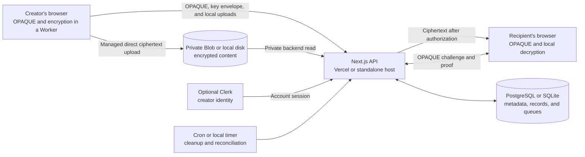

# Efemero

Temporary message and file sharing with browser-side encryption, password authentication before delivery, and server-enforced expiration policies.

**Application:** [efemero.rafael.run](https://efemero.rafael.run). **Repository:** private, at `toruticas/efemero`. The project name, identifiers, and domain use the ASCII spelling `efemero`.

Recipients need the link and the artifact password. The URL contains no key, password, or secret fragment. The server controls new deliveries; no policy can erase a copy a recipient has already received.

Repository documentation, code identifiers, comments, test descriptions, and maintainer-facing output use English. The product interface supports Brazilian Portuguese and English. Existing public routes and cryptographic protocol identifiers retain their original spelling for compatibility. See [internationalization](docs/internationalization.md) for language selection and translation maintenance.

The interface follows the system light/dark preference automatically, including live preference changes and Clerk account forms. Theme selection uses CSS only, without a theme cookie, local storage, or another runtime dependency.

Efemero also supports a single-container self-hosted installation with SQLite, local ciphertext storage, and no account provider. Cloud services are optional; the existing managed production deployment remains unchanged.

## Contents

- [Self-hosting](#self-hosting)
- [Status and validation scope](#status-and-validation-scope)
- [Product model](#product-model)
- [Architecture and technology choices](#architecture-and-technology-choices)
- [Passwords, OPAQUE, and content keys](#passwords-opaque-and-content-keys)
- [Creation and retrieval flows](#creation-and-retrieval-flows)
- [Expiration, kill-switch, and removal](#expiration-kill-switch-and-removal)
- [Privacy, statistics, and retention](#privacy-statistics-and-retention)
- [Limits and abuse prevention](#limits-and-abuse-prevention)
- [Security risks and limitations](#security-risks-and-limitations)
- [Development and configuration](#development-and-configuration)
- [Deployment and operations](#deployment-and-operations)
- [Repository structure and API](#repository-structure-and-api)
- [Validation and future work](#validation-and-future-work)

## Self-hosting

```sh
docker compose up -d --build
```

Open <http://localhost:3000>. The standalone image uses file-backed SQLite and private local storage, disables Clerk, generates and persists its own service secrets, and runs cleanup every five minutes. Keep its `/data` volume: it contains both encrypted artifacts and the server state needed to open them. No external service is required.

See the [self-hosting guide](docs/self-hosting.md) for TLS, volumes, ordinary PostgreSQL, optional Clerk, and the explicit opt-in for in-memory SQLite. Memory mode loses all database state on restart and can leave orphaned ciphertext on disk. SQLite/local storage are for a persistent single-host process, not Vercel Functions.

Repository defaults still select Neon and private Vercel Blob unless overridden. Docker supplies separate local defaults; it does not change the current Vercel + Neon production configuration.

## Status and validation scope

The project implements anonymous sharing, an account area, immutable usernames, custom IDs, paginated history, aggregate counters, revocation, and an optional kill-switch. The current managed production infrastructure uses Vercel Hobby, Neon, private Blob storage, and Clerk. Self-hosting can instead use SQLite, disk storage, and disabled accounts.

As of the 2026-10-19 verification:

- Anonymous sharing was exercised in Chromium against the actual services: creation, incorrect passwords, message decryption, byte-identical downloads, revocation, a single-delivery limit, and expiration without relying on cron. An anonymous file of exactly 2 MiB was also transferred.
- The five Clerk CNAME records are configured. HTTPS and rendering of the sign-in and sign-up forms work. `/app` redirects to sign-in without a session. The public pages inspected do not load the Clerk SDK.
- Before the self-hosting update, implementation CI passed with **47 tests**, real PostgreSQL 17, type checking, formatting, and a production build. This count describes that revision, not a permanent guarantee.
- **Sign-up, email verification, sign-in, and dashboard use with a real production account still require end-to-end validation.** Backend authorization tests and component tests with simulated responses do not replace that exercise.
- The cleanup route and its authorization were tested manually; this does not prove execution in the next scheduled daily window or the providers' internal deletion timelines.

The project has not undergone an independent cryptographic audit. The limitations below are part of the security model even when every test passes. The [validation log](docs/validation.md) contains dated evidence; older entries describe the state at that time and may precede later fixes.

The current 70-test suite has been exercised locally against PGlite and SQLite, alongside an offline Docker smoke test with restart checks and real Chromium transfers of 2 MiB. Bilingual browser checks cover cross-language sharing, language persistence, and preserved draft/result state. Detailed evidence is recorded in the validation log. These checks do not replace the outstanding real-account Clerk validation.

## Product model

### Artifacts and addresses

An artifact contains a message or a file. Its content and policy are set at creation and remain immutable after publication.

| Mode      | Address format   | Identity and management                                                                    |
| --------- | ---------------- | ------------------------------------------------------------------------------------------ |
| Anonymous | `/a/:id`         | No login required; random ID and a separate revocation credential.                         |
| Account   | `/:username/:id` | Requires a Clerk session and username; supports random or custom IDs and owner management. |

Anonymous IDs use 9 random bytes encoded as base64url, producing 12 characters. A custom ID accepts 1 to 48 ASCII characters, starts with a letter or digit, and may contain letters, digits, `_`, and `-`. Custom IDs can be predictable: content security must not depend on hiding the address.

Usernames contain 3 to 24 characters, start with a lowercase letter, and allow lowercase letters, digits, `_`, and `-`. System names are reserved. Immutability is enforced by the API and a database trigger. The username is public in URLs and should not contain information the creator wants to keep private.

A prefix and ID combination is never reused, even after content removal. This prevents an old link from pointing to a new artifact. The decision requires retaining residual database records, with privacy and growth implications described below.

### Policy set at creation

Every artifact has a mandatory lifetime. It may also have an authorized-delivery limit and, in account mode, a password-failure limit.

There is no content update, artifact-password change or recovery, lifetime extension, ID change, policy adjustment, or unblocking. The owner can permanently revoke/remove an artifact. Publishing another version requires creating a new artifact at a different address.

Clerk login authenticates the **creator** and authorizes history and management. The artifact password authenticates the **recipient** and enables content-key recovery in the browser. Signing into an account does not replace that password or provide content recovery. A login password, when used by Clerk, belongs to a separate flow from the artifact password.

## Architecture and technology choices



During normal operation, the browser sees the password, text, file, and keys in plaintext. The API receives OPAQUE messages and metadata required to enforce policies; Blob receives encrypted bytes. The server holds its own authentication and infrastructure-access secrets. This separation reduces data exposure, but does not make the operator unable to attack passwords or modify the frontend delivered to users.

| Technology                                | Role and reason for choosing it                                                                                                               | Trade-off or limitation                                                                                           |
| ----------------------------------------- | --------------------------------------------------------------------------------------------------------------------------------------------- | ----------------------------------------------------------------------------------------------------------------- |
| Next.js 16, React 19, and TypeScript      | Interface and API in one project, with direct Vercel integration.                                                                             | Dependency on the framework, security updates, and correct cache, header, and runtime configuration.              |
| Vercel Functions, Node.js runtime         | Backend without a dedicated server; receives proofs and streams authorized objects.                                                           | Execution limits, platform dependency, and request/transfer consumption. Routes have a 60-second `maxDuration`.   |
| PostgreSQL / SQLite                       | Persistent state and parameterized queries; PostgreSQL row locks or serialized SQLite write transactions enforce concurrent policy decisions. | Database downtime blocks authorizations. Abusive traffic can still consume database capacity.                     |
| **Private** Vercel Blob                   | Stores ciphertext; direct uploads avoid routing files through the Next.js API request body.                                                   | Physical deletion is asynchronous; tokens, operational consistency, and provider limits require attention.        |
| Clerk                                     | Creator sign-up and sessions without building an identity system.                                                                             | External service with its own DNS, certificates, availability, and data processing.                               |
| `@serenity-kit/opaque` 1.1.0              | Rust/WASM OPAQUE implementation, pinned in the lockfile, for authentication without transmitting the artifact password.                       | Sensitive cryptographic integration, memory cost, and server-secret management.                                   |
| Web Crypto and Web Worker                 | Browser-native AES-GCM and HKDF; cryptographic work off the interface thread.                                                                 | A Worker is not a secure enclave. Memory, the browser, and delivered JavaScript remain within the trust boundary. |
| Zod                                       | Strict input validation and rejection of unexpected fields.                                                                                   | Format validation does not prove cryptographic correctness or make a modified client trustworthy.                 |
| Vitest, PGlite, and real PostgreSQL in CI | Fast tests plus transaction and concurrency checks with independent connections.                                                              | Tests do not cover every browser, provider, or adversarial scenario.                                              |

There is no Redis, external broker, or additional queue service. Handshakes, rate limits, and the deletion queue live in the selected database, reducing operational components. Concurrency guarantees depend on this shared state, without counters held in a single Function's memory.

The backend is transient while handling requests, but the database and storage persist until cleanup. The product does not depend on a continuously running process to maintain a timer for each artifact.

## Passwords, OPAQUE, and content keys

### Why not send a static password hash?

If the API always accepted `hash(salt + password)` as a credential, someone who obtained that value could potentially replay it without discovering the original password. A static verifier also provides a way to check guesses offline. A salt makes precomputed tables harder to use; it does not prevent testing a password list. MD5 and SHA-256 alone are too fast to protect human passwords against such attempts.

OPAQUE is a password-authentication protocol with a message exchange and session-bound proof. The browser processes the password, the server participates using its own secret material, and the API requires a valid final proof before fetching ciphertext. The artifact password is never sent to the API, including during creation. Schemas reject a password field; this does not remove the need to keep logs and instrumentation free of sensitive data.

The client's cryptographic identifier is the artifact's immutable internal UUID. The server identity is the canonical origin in `APP_ORIGIN`. Usernames and short IDs only locate the record. Changing the canonical origin or OPAQUE material without a migration strategy can prevent existing artifacts from being opened.

### Secrets and responsibilities

| Material                    | Where it is used                                      | What it protects and its limits                                                                                                                                   |
| --------------------------- | ----------------------------------------------------- | ----------------------------------------------------------------------------------------------------------------------------------------------------------------- |
| Artifact password           | Creator's and recipient's browsers                    | Enables authentication and key recovery. Weak passwords remain vulnerable to guessing.                                                                            |
| `OPAQUE_SERVER_SETUP`       | Backend, outside artifact tables                      | Contains OPRF material and the server's private authentication key. Required to participate in the protocol and must be treated as a critical secret.             |
| OPAQUE registration record  | Selected database, per artifact                       | Enables authentication together with the setup. It is not a plaintext password, but is not harmless if server secrets leak.                                       |
| Client `exportKey`          | Browser Worker                                        | Provides the material for wrapping the content key; never sent to the API.                                                                                        |
| OPAQUE `sessionKey`         | Available to protocol participants                    | **Does not encrypt or wrap the content key**, because the server also knows it.                                                                                   |
| Data encryption key, or DEK | Random, per artifact; plaintext in the browser        | Encrypts the message/file and original metadata. Only its encrypted envelope is stored in the database.                                                           |
| `HANDSHAKE_SEAL_KEY`        | Backend                                               | Encrypts temporary protocol state in the database, bound to the artifact. Does not replace protection of the OPAQUE setup.                                        |
| Management credential       | Returned to the creator; SHA-256 hash in the database | Authorizes management operations, including revocation. It is a random 256-bit secret independent of the password. Its hash is not an artifact-password verifier. |

**Fundamental limit:** anyone who obtains the server's OPRF material and a corresponding registration record can make offline password guesses. The server's private authentication key is not required for this dictionary attack with OPRF material and a record. The operator has technical access to these materials. OPAQUE improves protection against an isolated database leak, but does not guarantee resistance to complete application compromise or a malicious operator.

OPAQUE does not itself encrypt the file. It authenticates the recipient and lets the client recover stable material to open the key envelope, as described below.

### Implemented cryptographic format

1. The browser performs OPAQUE registration and recovers the `exportKey`. The library's `memory-constrained` profile uses Argon2id with 64 MiB of memory, 3 iterations, and parallelism 4.
2. A random 32-byte DEK encrypts the payload using AES-256-GCM with a random 12-byte nonce. The payload includes a 4-byte header length, a JSON header with kind, name, and MIME type, and the content bytes. The original name and MIME type are also encrypted.
3. HKDF-SHA-256 derives a wrapping key from the UTF-8 encoding of the `exportKey`, using the UUID as salt and `artefatos:key-wrap:v1` as context.
4. A separate AES-GCM operation, with an independent nonce, encrypts the DEK. The database stores the version, nonce, and ciphertext of this envelope, alongside the OPAQUE record.
5. The payload ciphertext contains a version byte, the nonce, and the encrypted bytes with their GCM tag. The additional authenticated data for both content and envelope is `artefatos:payload:v1:<UUID>`.

The internal `artefatos:*` prefixes belong to the existing protocol despite the public name Efemero. They must not be renamed as a cosmetic change: doing so would break cryptographic compatibility. The application format is version 1.

GCM detects byte tampering without the correct key, and the contexts bind the operation to the artifact. This does not prove the sender's human identity or the safety of a received file. Anyone with the password can copy and redistribute the content.

## Creation and retrieval flows

### Creation

These steps describe the managed upload transport. In local-storage mode, the browser sends ciphertext to a one-shot, management-authorized PUT route instead of requesting a Blob token; completed files are published atomically without overwrite. Authentication, encryption, and commit checks remain in place.

1. The browser validates the input and starts OPAQUE registration in the Worker. In account mode, the API verifies the session and resolves ownership on the server.
2. `reserve` reserves the UUID, address, deadline, byte budget, and policy. The backend returns the OPAQUE response and management credential. The lifetime starts at reservation, not at upload completion.
3. The browser completes registration, encrypts the payload, and wraps the DEK. The password, plaintext DEK, and `exportKey` remain on the client.
4. `upload` authorizes a single token issuance for the reserved private Blob path, with a size limit, `application/octet-stream` type, no overwrite, and no multipart. The token expires within 15 minutes, also bounded by the artifact deadline.
5. The browser uploads ciphertext directly. `commit`, authorized by the management credential, submits the OPAQUE record and encrypted envelope. The backend checks the path, size, type, and private storage before publication.

An abandoned reservation is not publicly available. Republishing, replacing an object, or reviving an expired/revoked artifact is not supported.

### Retrieval and delivery

1. Opening the page does not download ciphertext. For account artifacts, the interface sends an aggregate page-open event without identifying the recipient.
2. After the user enters the password, the browser starts OPAQUE. `access/start` checks state, deadline, and limits before returning a challenge. Temporary server state is encrypted in the database for up to 120 seconds, or less if the artifact expires sooner.
3. The browser processes the challenge. An incorrect password does not produce a valid proof; the official client sends an invalid proof to conclude the attempt. Abandoning the exchange is also considered by the kill-switch policy.
4. `access/finish` opens a transaction, locks the artifact row, settles expired attempts, and consumes the handshake once. Only a valid proof can increment the delivery counter.
5. Authorization is committed to the database **before** the Blob read. The backend reads the private object without cache and streams the bytes in the POST response. The DEK envelope is sent in `X-Wrapped-Key`, and the UUID in `X-Artifact-Id`.
6. The browser recovers the key and decrypts locally. Messages are displayed as text; files are offered as binary downloads, without rendering active documents on the site's origin.

Recipients do not receive a reusable signed GET URL that could bypass counters. The response uses `private, no-store` and `nosniff`. These headers instruct clients and intermediaries; they cannot stop an authorized client from saving bytes.

An authorized delivery can consume the limit even if storage, the network, or decryption later fails. There is no automatic refund or download resumption. Authorizing first prevents the same proof from being reused for multiple deliveries.

PostgreSQL row locks or SQLite write transactions serialize concurrent proofs, the final allowed access, revocation, and the kill-switch. An already authorized transfer may continue after concurrent revocation: the policy prevents **new authorizations**, without reclaiming bytes already released.

## Expiration, kill-switch, and removal

### States

| State       | Meaning                                                                                         |
| ----------- | ----------------------------------------------------------------------------------------------- |
| `pending`   | Unpublished reservation; publication window of up to 15 minutes, bounded by the total lifetime. |
| `ready`     | Published, subject to deadline and limit checks on every authorization.                         |
| `revoked`   | Revoked by the owner or management credential.                                                  |
| `expired`   | Lifetime elapsed or abandoned reservation processed by cleanup.                                 |
| `exhausted` | Authorized-delivery limit reached.                                                              |
| `destroyed` | Kill-switch failure limit reached.                                                              |

`purged_at` separately records completion of object deletion. A terminal state does not mean every physical copy disappeared at that instant. History may show an effective expired state before cleanup persists the transition.

The deadline is checked at both authentication start and completion, using the server clock. Expired access is therefore denied even if cron does not run. For time-based expiration, the OPAQUE record and key envelope are removed from the database when cleanup processes the artifact. Revocation, final access, and the kill-switch remove these materials in the transaction that ends availability.

### Kill-switch: protection with a denial-of-service risk

In account mode, the creator can set a limit of 1 to 100 accumulated failures. The option is disabled by default and immutable after creation. A successful authentication does not reset prior failures.

An invalid proof consumes the handshake and counts as a failure. To prevent a client from simply withholding its response after discovering a wrong guess, abandoned handshakes also count after expiration. They are settled at the next access start/completion or by cleanup; there is no dedicated timer firing exactly at second 120.

Pending challenges are bounded by the remaining failure budget. When every slot is occupied, new starts receive a temporary rejection instead of destroying the artifact merely because additional challenges were requested.

**Anyone who knows the link can deliberately cause failures or abandon challenges and destroy the artifact.** Closing the page, a slow connection, or a network interruption can also consume attempts, even when the person intended to use the correct password. This is an inherent trade-off, not a way to distinguish attackers from legitimate recipients.

### Physical cleanup and reconciliation

Vercel cron calls `/api/cron/cleanup` daily using `CRON_SECRET`. The database-backed queue uses leases and PostgreSQL `FOR UPDATE SKIP LOCKED` or SQLite write transactions to coordinate executions and support retries after failures. Standalone Docker uses an in-process timer rather than Vercel Cron.

Deletion respects a safety window: eligibility considers the current time, 90 seconds after the latest authorized delivery, and 90 seconds after upload-token validity, as applicable. This avoids interfering with authorized transfers and reduces races with still-valid uploads.

An invocation drains batches of 20 jobs, with a 45-second budget and up to 500 batches, within the Function's 60-second configuration. Failures defer eligibility by 5 minutes; **this does not guarantee another execution in 5 minutes**, because the scheduler runs daily. The response reports `limited` when the work budget is exhausted.

A paginated Blob inventory with a persisted cursor also removes objects that reappear after an upload started before token expiration. Reconciliation may require several invocations to scan storage.

Backlogs, outages, scheduler failures, or execution timeouts can delay physical deletion beyond the next day. There is no 24-hour deletion SLA or proof of erasure from provider backups, caches, or internal replicas. Access expiration does not depend on that deletion.

## Privacy, statistics, and retention

### What each party knows

| Location                             | Data present during normal operation                                                                                                                            |
| ------------------------------------ | --------------------------------------------------------------------------------------------------------------------------------------------------------------- |
| Browser                              | Artifact password, content, original name and MIME type, temporary keys; recipients can keep their copy.                                                        |
| Selected database                    | Account and Clerk ID, username, URL, UUID, dates, policy, declared size, state, counters, storage path, OPAQUE record, and encrypted key envelope while needed. |
| Private Blob                         | Encrypted payload, size, and operational object metadata; original name and MIME type are inside the encrypted payload.                                         |
| Clerk                                | Identity, session, and access-protection data according to the service's configuration and policies.                                                            |
| Network infrastructure and providers | May observe IP addresses, hostnames, accessed URLs, timestamps, sizes, and operational logs according to their position and policies.                           |

There is no padding to hide size. Ciphertext size reveals the approximate content size. Dates, access frequency, and usernames may also reveal relationships between users and artifacts.

“Anonymous” means creation and retrieval do not require an account. It does not mean network anonymity, inability to correlate activity, or absence of provider logs. Share passwords through a channel separate from the link and avoid sensitive information in usernames or custom IDs, which are public.

The code does not add recipient analytics or intentionally log passwords, content, OPAQUE messages, credentials, or raw provider errors in handlers. Optional Clerk SDK telemetry is disabled. This does not disable Clerk's protection mechanisms or guarantee the behavior of all infrastructure logging.

### What the counters measure

The dashboard lists account-artifact metadata with pagination, state, and permanent removal. It does not keep a plaintext content copy for the owner.

- **Page opens:** aggregate events sent by the recipient interface. These are estimates; reloads, bots, blockers, network failures, and artificial requests can affect the count. They are not unique people or a recipient audit trail.
- **Authorized deliveries:** accepted OPAQUE proofs that consumed an authorization. They do not prove download completion, successful decryption, or human reading.
- **Failures:** attempts counted by the kill-switch policy, including abandoned challenges settled after expiration.

There is no reliable measure of the “number of decryptions” on a client controlled by the recipient. A browser acknowledgment could be omitted or fabricated. The product therefore does not present that number as a verifiable fact.

### What remains after deletion

After object removal, cleanup clears its storage URL, management hash, and protocol material from the record. Account history stops listing artifacts purged more than 30 days ago. A later cleanup removes their direct `owner_id` association, resets counters, and reduces other history-related fields.

**The artifact row is not deleted.** Residual records, or tombstones, prevent URL reuse. They still include the address, UUID, namespace, slug, state, timestamps, and operational fields. An account artifact's namespace remains the public username: removing `owner_id` does not make the record anonymous. Anonymous tombstones likewise do not undergo a general deletion of all metadata.

Accounts and usernames remain in the database; no complete account-deletion flow or deletion synchronization from Clerk is implemented. Tombstones grow without a final deletion deadline. The 30-day retention rule concerns history after purge, not erasure of all personal data within 30 days.

Rate-limit keys are HMACs of network identity, scope, and time bucket, without raw IP storage in that table. Rows expire logically at the end of the window and are removed by cleanup; they may remain physically longer if cleanup fails. HMAC does not make IP addresses impossible to correlate for someone who controls the secret.

Provider backups and records have separate lifecycles. Restoring an old database can restore old metadata or permissions; operational recovery requires reassessing deadlines, revocations, and objects. There is no complete automated disaster-recovery procedure with these guarantees.

## Limits and abuse prevention

### Application limits

| Resource                                 | Current limit                                                                          |
| ---------------------------------------- | -------------------------------------------------------------------------------------- |
| Anonymous file                           | 2 MiB of content in the official client.                                               |
| File created in the account area         | 5 MiB of content in the official client.                                               |
| Message                                  | 256 KiB.                                                                               |
| Lifetime                                 | 1 minute to 7 days, mandatory, counted from reservation.                               |
| Authorized deliveries                    | Optional, 1 to 100; an unlimited delivery count still has a deadline.                  |
| Kill-switch                              | Optional, 1 to 100 accumulated failures, account artifacts only.                       |
| Password in the official client          | 12 to 256 characters; prefer a generated password or a long, unpredictable passphrase. |
| Artifacts not yet purged per account     | 50, including reservations and items awaiting deletion.                                |
| Global budget for objects not yet purged | 1 GiB of declared ciphertext sizes, reserved atomically in the database.               |
| JSON body on control routes              | Up to 32 KiB; files upload directly to Blob.                                           |
| Retrieval handshake                      | Up to 120 seconds, bounded by the artifact deadline.                                   |

MiB means `1024 × 1024` bytes. The interface uses the MB label; code limits are binary. The API allows up to 4 KiB of ciphertext overhead for the header and additional encrypted-format bytes. The DEK envelope is stored separately in the database. Since the API cannot see plaintext, it limits ciphertext bytes and cannot verify the exact original size or content kind from a modified client. The message-size restriction is also enforced by the official client.

The same applies to password quality and length: since the API does not receive the password, it cannot prove its entropy or enforce the client's textual validation. A modified client can choose a weak password. No cryptographic policy transforms that choice into a strong password.

The reader retains compatibility with older ciphertexts of up to 25 MiB plus format overhead. This does not allow new 25 MiB uploads; new artifacts follow the 2/5 MiB limits.

### Rate limits

Fixed windows use atomic database updates. “Per network” means the identity derived from Vercel's forwarding header; outside Vercel, requests share a conservative local identity rather than trusting arbitrary IP headers.

| Operation          | Per network        | Other limits                                                  |
| ------------------ | ------------------ | ------------------------------------------------------------- |
| Reserve artifact   | 5 per hour         | 100 per hour service-wide.                                    |
| Issue upload token | 20 per hour        | Token and reservation rules.                                  |
| Publish            | 30 per hour        | Management credential and reservation state.                  |
| Start retrieval    | 30 per 15 minutes  | 15 per artifact per 15 minutes; 600 per minute service-wide.  |
| Complete retrieval | 60 per 15 minutes  | Single-use handshake and artifact policy.                     |
| Count page open    | 120 per 15 minutes | 120 per artifact per 15 minutes; 600 per minute service-wide. |
| Revoke             | 30 per hour        | Credential or owner session.                                  |
| Set username       | 10 per hour        | One definition per account, no updates.                       |

Network quotas are shared by people behind NAT and also apply to authenticated users. Some checks happen before full validation; invalid requests can consume quota. Distributed attacks, global limits, and database contention can still deny legitimate use. These mechanisms reduce abuse but do not guarantee DDoS resistance or a spending cap.

The 1 GiB budget limits object reservations, not transfer, total database storage, tombstones, API operations, or all provider costs. These values are project decisions, not a reproduction of each provider's commercial plan quotas.

## Security risks and limitations

The scenarios below describe system trade-offs and failure modes. They should not be read as a report of exploited vulnerabilities or a completed audit.

| Scenario                                      | Existing protection                                                         | Remaining risk                                                                                                                                                     |
| --------------------------------------------- | --------------------------------------------------------------------------- | ------------------------------------------------------------------------------------------------------------------------------------------------------------------ |
| Someone knows the link but not the password   | OPAQUE before delivery, private Blob, and attempt limits.                   | Online guessing, address enumeration, and denial of service. URLs are not secret credentials, and artifact existence is not completely hidden.                     |
| Isolated database or storage leak             | Content and DEK encryption; OPAQUE setup separate from tables.              | Metadata leaks. Protection changes if the attacker also obtains backend secrets.                                                                                   |
| OPRF material and registration records leak   | Argon2id derivation cost and strong passwords.                              | Offline dictionary attacks ignore rate limits and the kill-switch. A “non-reversible hash” does not mean a password cannot be discovered.                          |
| Malicious operator, deployment, or dependency | CSP, pinned dependencies, and script separation reduce accidental exposure. | Anyone changing delivered JavaScript can capture passwords and plaintext before encryption. The operator also has the technical ability to test passwords offline. |
| Compromised browser, extension, or device     | Worker, Web Crypto, and clearing of some buffers.                           | Screenshots, clipboard, memory, extensions, malware, swap, and garbage-collected strings. Secure browser-memory erasure is not guaranteed.                         |
| Replay or final-access race                   | Single-use handshake, transaction, and row lock.                            | An authorized transfer may continue; later failures may consume the final release.                                                                                 |
| Deliberately triggered kill-switch            | Rate limits and a pending-challenge budget.                                 | Anyone who knows the URL can cause destruction without the password. Unstable networks can also consume attempts.                                                  |
| Delayed cron or unavailable storage           | API deadline checks and persistent queue with retries and reconciliation.   | Ciphertext and some material may remain stored after access is blocked. Provider backups are not erased by the queue.                                              |
| Lost or incorrectly rotated secrets           | Separate configuration and recorded setup version.                          | Artifacts may become unrecoverable or ongoing authentication may fail; no migration keyring is implemented.                                                        |
| Dangerous file from an authorized sender      | No active preview, binary MIME type, and name recovery only on the client.  | There is no malware scan of encrypted content. Opening the file in another application may be dangerous.                                                           |
| Compromised Clerk account                     | Backend ownership checks; artifact password remains separate.               | The attacker can inspect metadata and remove account artifacts. Account administration does not automatically provide the decryption password.                     |
| Provider outage or quota exhaustion           | No delivery when authorization cannot be proven.                            | Dependency on Vercel, Neon, Blob, Clerk, and DNS. Failing closed protects access but does not keep the service available.                                          |

### Application defenses and their scope

Mutations check the canonical origin and cross-site context, with separate handling for authenticated upload-SDK callbacks. This helps prevent browser CSRF; a non-browser client can fabricate `Origin`, so it does not replace a credential, session, or OPAQUE proof.

The API uses strict schemas, parameterized SQL, server-resolved ownership, and error responses without raw provider details. Storage paths, accounts, and policies are not trusted merely because a client supplied them. Blob access requires a backend token, and publication verifies private storage.

The CSP uses a per-response nonce, `strict-dynamic`, explicit WASM support, and object/embedding restrictions. Production does not allow JavaScript `unsafe-eval`; development has additional permissions. Inline styles remain allowed. Only account pages receive `blob:` workers and extra Clerk Protect permissions, including HTTPS connections on non-default ports. These permissions are a concrete dependency of Clerk's protection, not absolute isolation of third-party scripts.

Public pages do not mount `ClerkProvider`; the account flow loads its own services. CSP reduces some injection opportunities but cannot protect against malicious code authorized by a deployment or prove the absence of XSS in future changes.

The service must not promise absolute “zero knowledge,” strong anonymity, irrecoverable erasure, or security independent of passwords, devices, and the operator. TLS remains mandatory for public production origins even with content encryption; only standalone loopback permits HTTP.

## Development and configuration

### Prerequisites and a separate environment

- Node.js 24 and npm; CI and the standalone image use Node.js 24.
- A separate development database. `DATABASE_DRIVER=neon` uses Neon WebSockets, `postgres` uses standard PostgreSQL TCP, and `sqlite` uses a local file. See the self-hosting guide for local options.
- A **private** Blob store dedicated to the environment, or `STORAGE_DRIVER=local` with a dedicated private directory.
- A development Clerk instance/keys to exercise accounts. Without them, anonymous sharing can work, but the account area is unavailable.

Do not use production databases, buckets, or secrets for development or tests. A Git-ignored file is not safe to share or print. In particular, do not leave `.env.production.local` in a development checkout: the migration runner loads configuration through `@next/env`, whose selection may prioritize production files. Privately verify the effective target before migrating, without printing the connection string to logs.

```sh
npm ci
cp .env.example .env.local
npm run setup:secrets
```

Fill `.env.local` with the local origin, connections, and development-environment tokens. Then run:

```sh
npm run db:migrate
npm run dev
```

The generator fills only missing secrets and does not print their values. It preserves populated entries; it does not validate or automatically repair placeholders or incorrect configuration. Do not treat it as a production-rotation procedure. `.env.local` and other local environment files are Git-ignored.

Without the required configuration, pages may remain accessible, but sharing is disabled. There is no fallback that sends plaintext passwords or releases content to work around missing services.

### Environment variables

| Variable                            | Purpose and precautions                                                                                                                                                                                   |
| ----------------------------------- | --------------------------------------------------------------------------------------------------------------------------------------------------------------------------------------------------------- |
| `APP_ORIGIN`                        | Canonical origin, for example `http://localhost:3000` in development. Public production origins require HTTPS; standalone loopback HTTP is allowed. It participates in OPAQUE identity and origin checks. |
| `DATABASE_DRIVER`                   | `neon` by default; also supports `postgres` and `sqlite`.                                                                                                                                                 |
| `STORAGE_DRIVER`                    | `vercel-blob` by default, or `local`.                                                                                                                                                                     |
| `AUTH_PROVIDER`                     | `clerk` by default; `none` explicitly disables account authentication.                                                                                                                                    |
| `SQLITE_PATH`                       | Local database path; `:memory:` requires `ALLOW_EPHEMERAL_DATABASE=true`.                                                                                                                                 |
| `LOCAL_STORAGE_PATH`                | Dedicated private ciphertext directory for local storage.                                                                                                                                                 |
| `CLEANUP_INTERVAL_SECONDS`          | Standalone timer, `0` by default outside Docker; Docker uses `300`. Vercel keeps external cron.                                                                                                           |
| `DATABASE_URL`                      | Backend PostgreSQL connection for Neon or standard TCP; never expose it to the browser.                                                                                                                   |
| `BLOB_READ_WRITE_TOKEN`             | Private-store access. Never use the `NEXT_PUBLIC_` prefix.                                                                                                                                                |
| `OPAQUE_SERVER_SETUP`               | Secret OPAQUE setup generated by the library. Preserve it to open existing records.                                                                                                                       |
| `OPAQUE_SETUP_VERSION`              | Identifies the setup version; defaults to `1`. Does not itself implement reads with multiple setups.                                                                                                      |
| `HANDSHAKE_SEAL_KEY`                | Encryption key for temporary authentication state.                                                                                                                                                        |
| `RATE_LIMIT_HMAC_KEY`               | Secret for pseudonymizing rate-limit identities.                                                                                                                                                          |
| `CRON_SECRET`                       | Authorizes the cleanup route; send only as a backend credential.                                                                                                                                          |
| `NEXT_PUBLIC_CLERK_PUBLISHABLE_KEY` | Publishable key for the environment's Clerk instance; may be included in the client bundle.                                                                                                               |
| `CLERK_SECRET_KEY`                  | Clerk secret key, backend only.                                                                                                                                                                           |
| `NEXT_PUBLIC_CLERK_SIGN_IN_URL`     | Sign-in route: `/sign-in`.                                                                                                                                                                                |
| `NEXT_PUBLIC_CLERK_SIGN_UP_URL`     | Sign-up route: `/sign-up`.                                                                                                                                                                                |

Do not copy real values into the README, issues, screenshots, fixtures, or CI output. Different environments must have different secrets. A preview must not automatically receive production infrastructure.

### Migrations

`npm run db:migrate` applies numbered PostgreSQL files from `migrations/` in order, within a transaction using an advisory lock and `schema_migrations` tracking. Applied migrations do not run again. Future changes should add a new file rather than rewrite applied history.

PostgreSQL builds and requests do not run migrations automatically. SQLite applies its separate `migrations/sqlite/` files transactionally when opened, including standalone startup. Changes that depend on new columns must coordinate database migration with code deployment. A fresh-database CI test does not mean the production schema has been updated.

## Deployment and operations

### Vercel Hobby and regions

Changes to `main` trigger a production deployment through the Git integration. Daily deployments are not required. The daily task is cleanup cron running against the existing deployment.

`vercel.json` fixes Functions in `iad1` and schedules `0 3 * * *`: 03:00 UTC, nominally 00:00 in São Paulo. On Hobby, actual timing follows the platform scheduler's window and limitations; this is not a commitment to execution at the exact minute.

The current installation uses Functions/Blob in the US and Neon in `aws-us-east-1`. This keeps processing and data close, but does not guarantee that Clerk, logs, backups, traffic, or subprocessors remain entirely in that region. The remote development environment's region is independent of the application region. There is no guarantee of exclusively Brazilian or Latin American data residency.

The project must remain on Hobby. File limits, a storage budget, and daily cron reduce consumption, but do not guarantee that every service is free or that every intended use complies with provider terms. Provider quotas, prices, and policies must be checked before expanding use; the application does not purchase upgrades automatically.

### Clerk, domain, and environments

The app is hosted at `efemero.rafael.run`; the primary production domain configured in Clerk is `rafael.run`, with services at `clerk.rafael.run` and `accounts.rafael.run`. DNS is managed by Vercel. The five CNAMEs cover the frontend, portal, and email authentication; specific values are in the [deployment guide](docs/deployment.md).

Correct DNS and certificate issuance are separate steps. Configuring a domain alone does not publish the application or prove login works. Records must exactly match Clerk's targets while preserving valid existing email policies. Do not replace them with a wildcard or disable TLS validation to bypass failures.

Sharing dependencies are provisioned in production; previews must not be assumed complete or isolated just because their URLs differ. Provision dedicated resources and secrets before testing sharing in a preview. Clerk keys, origin, database, Blob, and OPAQUE setup must correspond to the same environment.

### Secrets, recovery, and operational signals

OPAQUE does not remove the need to protect server secrets. Access control for Vercel, Neon, Clerk, GitHub, DNS, and automation tokens is part of product security. Frontend changes affect the boundary that sees plaintext passwords.

Losing the OPAQUE setup may make existing artifacts unrecoverable even with the correct password. Changing `OPAQUE_SETUP_VERSION` neither migrates records nor makes the old setup available. No keyring or production key migration is implemented. A planned replacement requires an explicit strategy, such as waiting for all active artifacts to expire before replacing the setup. A compromise requires incident response and a decision about invalidating artifacts; simply replacing an environment variable does not undo prior exposure.

Changing `HANDSHAKE_SEAL_KEY` may invalidate ongoing authentication. Changing the canonical origin affects existing records. Backups must protect secrets and data with restricted access, acknowledging the tension between retention/recoverability and ephemerality.

Useful operational signals include the latest successful cleanup, queue age, `limited` responses, deletion failures, storage/database use, request volume, provider errors, and certificate validity. A complete alerting and automated recovery layer is not implemented. Additional observability should use aggregate data without capturing passwords, payloads, tokens, envelopes, or protocol messages.

## Repository structure and API

| Path                                        | Responsibility                                                                   |
| ------------------------------------------- | -------------------------------------------------------------------------------- |
| `src/app/`                                  | Pages, layouts, and HTTP routes.                                                 |
| `src/components/`                           | Creation, retrieval, history, and revocation interfaces.                         |
| `src/workers/crypto.worker.ts`              | Browser OPAQUE and cryptographic execution.                                      |
| `src/lib/crypto.ts`                         | Encrypted format, DEK wrapping, and decryption.                                  |
| `src/lib/protocol.ts`                       | Shared limits and types; version and OPAQUE profile.                             |
| `src/server/artifacts.ts`                   | State machine, authorizations, counters, and deletion.                           |
| `src/server/accounts.ts`                    | Clerk identity and immutable username.                                           |
| `src/server/database/`                      | Neon/TCP PostgreSQL connections, SQLite transactions, and shared database types. |
| `src/server/storage/local.ts`               | Private filesystem ciphertext storage and bounded atomic uploads.                |
| `Dockerfile`, `compose.yaml`, and `docker/` | Standalone image, durable volume, and runtime secret initialization.             |
| `src/server/storage.ts`                     | Private Blob access and inventory.                                               |
| `src/server/daily-cleanup.ts`               | Cleanup draining within a work budget.                                           |
| `src/proxy.ts`                              | CSP, nonce, cache, and session integration on relevant routes.                   |
| `migrations/` and `scripts/`                | Versioned schema, migrations, and initial secret generation.                     |
| `tests/`                                    | Cryptography, service, HTTP, and concurrency tests.                              |
| `.github/workflows/ci.yml`                  | Automated validation on Node.js 24 and PostgreSQL 17.                            |

The central tables are `accounts`, `artifacts`, `handshakes`, `rate_limits`, `cleanup_jobs`, `maintenance`, and `schema_migrations`. Plaintext messages and files are not stored in a database table.

| Method and route                    | Purpose and authorization                                                                |
| ----------------------------------- | ---------------------------------------------------------------------------------------- |
| `POST /api/artifacts/reserve`       | Reservation and OPAQUE registration start; session required in account mode.             |
| `POST /api/artifacts/upload`        | Restricted token issuance and upload-SDK callbacks.                                      |
| `PUT /api/artifacts/upload/local`   | Local-mode-only upload with one-shot management authorization; unavailable in Blob mode. |
| `GET /api/health`                   | Minimal configuration/database readiness check.                                          |
| `POST /api/artifacts/commit`        | One-time publication with management credential and object verification.                 |
| `POST /api/artifacts/access/start`  | Recipient authentication start; no content delivery.                                     |
| `POST /api/artifacts/access/finish` | Final proof, authorization consumption, and binary response.                             |
| `POST /api/artifacts/access/visit`  | Aggregate page-open counting for account artifacts.                                      |
| `POST /api/artifacts/revoke`        | Revocation by management credential or owner session.                                    |
| `GET /api/account`                  | Cursor-paginated history of the authenticated account.                                   |
| `POST /api/account`                 | One-time username selection with a Clerk session.                                        |
| `GET /api/cron/cleanup`             | Maintenance protected by `Authorization: Bearer` using `CRON_SECRET`.                    |

Main pages are `/`, `/a/:id`, `/:username/:id`, `/app`, `/sign-in`, `/sign-up`, `/revogar`, and `/sobre`. APIs are internal to the application and subject to origin and credential checks; this table does not establish a public external-integration contract.

## Validation and future work

### Verification commands

```sh
npm run typecheck
npm test
npm run format:check
npm run build
```

`npm run check` combines types, tests, and build; formatting has a separate command. The build uses Webpack, including the cryptographic Worker.

SQL tests use PGlite by default. `npm run test:sqlite` runs the same lifecycle/concurrency suite against SQLite; `sh scripts/test-docker.sh <local-image>` exercises the standalone image without outbound network access, including persistent and in-memory restart behavior. To run with real PostgreSQL and concurrent connections, configure `TEST_DATABASE_URL` with a **disposable** database, never production. The suite creates an isolated schema and removes it afterward. In CI, PostgreSQL 17 runs as a separate service.

Tests exercise the actual OPAQUE library, export-key stability, incorrect passwords, cryptographic integrity and isolation, authentication before storage reads, replay, expiration, concurrent final access, revocation, kill-switch, abandoned challenges, account scoping, pagination, and cleanup retries. Simulated storage adapters and component tests have narrower scope than complete operations against actual providers.

Dependency analyses detect only known vulnerabilities in the sources consulted. A clean run does not demonstrate the absence of flaws, protocol correctness, or build-chain security. Cryptographic-flow changes require specific review even when types and tests still pass.

### Remaining work

- Complete sign-up, email verification, sessions, and management with a real production account, and confirm automatic cron execution.
- Exercise real Safari/iOS, maximum authenticated upload sizes, and mobile networks; Chromium at a small viewport does not equal a real iPhone. Argon2id cost and buffer copies may strain memory and execution time on modest devices.
- Obtain an independent review of OPAQUE integration, key composition, attempt policy, and authorization boundaries.
- Continuously review Clerk security configuration, including allowed subdomains and `authorizedParties`; the current code does not implement an explicit `authorizedParties` allowlist.
- Define cleanup and capacity alerts, incident response, disaster recovery, and secret rotation/migration procedures without recording sensitive data.
- Minimize residual metadata, define a complete account-deletion policy, and assess every provider's retention and backups.
- Reassess abuse and costs before expanding use. Multipart uploads, transfer resumption, and incremental large-file encryption in the browser are not implemented.

Report security issues through a private channel with the maintainer, describing impact and a minimal reproduction using synthetic data. Do not publish passwords, tokens, URLs containing real content, or environment files. This repository does not document a formal vulnerability-disclosure program.

### Documentation and references

- [Self-hosting and standalone Docker](docs/self-hosting.md).
- [Architecture decisions](docs/architecture.md).
- [Implemented protocol](docs/protocol.md).
- [Configuration and deployment](docs/deployment.md).
- [Validation evidence and outstanding checks](docs/validation.md).
- [OPAQUE — RFC 9807](https://www.rfc-editor.org/rfc/rfc9807.html).
- [OPRF — RFC 9497](https://www.rfc-editor.org/rfc/rfc9497.html).
- [Serenity Kit OPAQUE implementation](https://github.com/serenity-kit/opaque).
